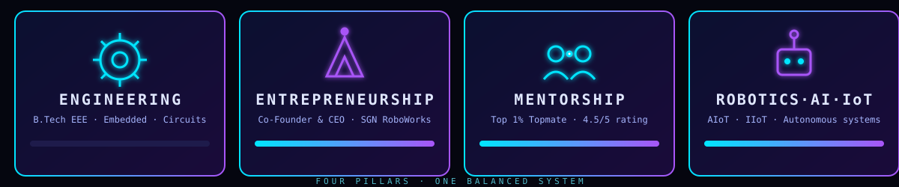
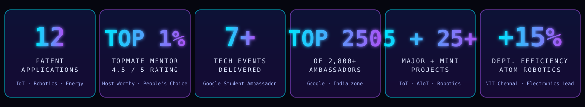
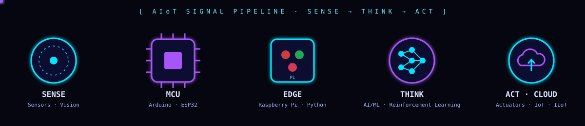

<div align="center">



<a href="https://git.io/typing-svg"></a>

<br/>

[](https://ngokulnath.vercel.app)
[](https://linkedin.com/in/n-gokulnath-ba8709277)
[](https://topmate.io/n_gokulnath)
[](https://medium.com/@gokulh2263)
[](mailto:gokulnath24nk@gmail.com)


</div>

## 🛰️ `> ACCESSING IDENTITY…`

<table>
<tr>
<td width="260" align="center" valign="top">


**N. GOKULNATH**
<br/>`Robotics Trainer · IoT Dev`
<br/>📍 Chennai, India

</td>
<td valign="top">

```ts
const gokulnath = {
  role:      ["Robotics Trainer", "IoT & Embedded Systems Developer", "STEM Educator"],
  founder:   "Co-Founder & CEO @ SGN RoboWorks (Aug 2025 → Present)",
  mentor:    "Top 1% Mentor @ Topmate · 4.5/5 ⭐",
  education: "B.Tech EEE · VIT Chennai (2022 – 2026)",
  patents:   12,                       // published applications
  leads:     "ex-Electronics Dept. Head @ ATOM Robotics, VIT Chennai",
  google:    "Student Ambassador · Top 250 of 2,800+ in zone",
  languages: ["Tamil", "English", "Hindi"],
  mission:   "Turn engineering concepts into project-based, beginner-friendly learning",
  status:    "🟢 Open to mentoring · robotics workshops · collaborations"
};
```

</td>
</tr>
</table>


## 🧬 `> CORE MATRIX` — Engineering · Entrepreneurship · Mentorship · Robotics/AI/IoT




## 📡 `> IMPACT TELEMETRY`




## 🧪 `> AI LABORATORY` — Tools & Technology Ecosystem



<div align="center">

**Hardware & Embedded**


**AI · IoT · Robotics**


**Software & Platforms**


</div>

<details>
<summary><b>⚡ Full skill matrix (click to expand)</b></summary>

| Domain | Skills |
|---|---|
| 🎓 **STEM Education & Training** | Robotics Training · STEM Curriculum Development · Workshop Design & Facilitation · Project-Based Learning · DIY Kit-Based Teaching · Student Mentoring · Lesson Planning · Lab Management · Public Speaking · Technical Documentation · Project Assessment |
| 🤖 **Robotics & Electronics** | Robotics Programming · Sensor & Actuator Integration · Motor Control · Obstacle Detection · Autonomous Navigation · Circuit Design · Prototyping · Troubleshooting · Smart Grids · Renewable Energy Systems |
| 🧠 **Embedded, IoT & AI** | Embedded Systems Design · Embedded C · IoT Protocols · IoT, IIoT & AIoT · AI/ML Integration · Reinforcement Learning · Signal Processing · Cloud Fundamentals |
| 🛠️ **Tools & Platforms** | Arduino · ESP32 · Raspberry Pi · Python · Java · Embedded C · Game Development · UI/UX Design |
| 🚀 **Leadership** | Team Leadership · Event Management · Community Building · Project Management · Communication · Problem Solving · Agile Methodologies |

</details>


## 📊 `> GITHUB ANALYTICS CORE`

<div align="center">


### 🐍 Contribution Snake


</div>


## 🚀 `> PROJECT SHOWCASE` — 12 Patent Applications

> Published patent applications across **IoT, robotics, renewable energy and smart systems**. Click a title to view the filing.

| # | Invention | Application No. | Domain |
|:-:|---|:-:|---|
| 01 | 🚁 [A Robotic Device for Rescue Operations](https://ngokulnath.vercel.app/N.Gokulnath-patent-1.jpg) | `202441092357` | Rescue Robotics · RL Navigation |
| 02 | 📬 [Smart Secure Mailbox](https://ngokulnath.vercel.app/N.Gokulnath-patent-2.jpg) | `202541078678` | IoT · AI · Smart Systems |
| 03 | 🌊 [Buoy System for Monitoring Seaweed](https://ngokulnath.vercel.app/N.Gokulnath-patent-3.jpg) | `202541019392` | Marine IoT |
| 04 | 🏠 [Integrated Environmental Monitoring System](https://ngokulnath.vercel.app/N.Gokulnath-patent4.jpg) | `202541078678` | Home Automation · Sensing |
| 05 | 🐝 [Swarm-Based AI-Powered Moored Buoy](https://ngokulnath.vercel.app/N.Gokulnath-patent-5.png) | `202541078699` | Swarm AI · Marine |
| 06 | 🌾 [System with Autonomous Agricultural Navigation](https://ngokulnath.vercel.app/N.Gokulnath-patent-6.jpeg) | `202541092483` | AgriTech Robotics |
| 07 | 🌲 [Robotic System for Forest Lifecycle Management](https://ngokulnath.vercel.app/N.Gokulnath-patent-7.jpeg) | `202541103034` | Environmental Robotics |
| 08 | 🧭 [Autonomous Robot to Navigate Towards a Point of Interest](https://ngokulnath.vercel.app/N.Gokulnath-patent-8.jpeg) | `202541101326` | Autonomous Navigation |
| 09 | ♻️ [System and Method for Management of Landfills](https://ngokulnath.vercel.app/N.Gokulnath-patent-9.png) | `202541115679` | Waste Management · IoT |
| 10 | ⚡ [Fault Detection & Efficiency in Hybrid Renewable Energy](https://ngokulnath.vercel.app/N.Gokulnath-patent-10.jpeg) | `202541126414` | Renewable Energy · Smart Grid |
<!-- ADD PATENTS 11 AND 12 HERE (same table format) -->

**More builds**

- 🦯 **Obstacle Detection System for the Vision Impaired** — sensor-based assistive device
- 🎮 **Snowbound: Rebuild Their World** — gamified climate-education game built under CSIR–NCL Jigyasa with CSIR scientists & IIT Bombay faculty
- 🧰 **5 major projects + 25+ smaller projects** in IoT, AIoT, robotics, embedded systems and automation — classroom demos & student project templates
- 🔬 **RL-based rescue robot (2024):** **20%** reduction in response time and **45%** better pathfinding accuracy in simulated rescue missions


## 🎞️ `> MISSION LOG` — Experience Timeline

| Period | Role | Highlights |
|---|---|---|
| **Aug 2025 → Present** | 🚀 **Co-Founder & CEO — SGN RoboWorks**, Chennai | STEM & robotics venture · workshops for schools/colleges · DIY robotics kits · guiding mini, final-year & capstone IoT/AIoT/robotics projects |
| **Jul 2026 → Present** | 🎤 **Mentor (Top 1%) — Topmate** | 1:1 mentoring, webinars & technical sessions · **4.5/5** · Host Worthy, People's Choice & Community Care badges |
| **Jan 2025 → Apr 2026** | 🔌 **Electronics Dept. Head / Lead — ATOM Robotics, VIT Chennai** | Led the department · **+15% efficiency** · mentored juniors in circuits, sensors & microcontrollers |
| **Apr 2024 → Feb 2025** | 🤖 **Robotics Developer — ATOM Robotics** | Intelligent robots with sensors, MCUs & actuators · integrated ML into robots |
| **Sep 2025 → Feb 2026** | 🌐 **Google Student Ambassador (India)** | **7+ events** on AI, IoT, robotics, cloud, prompt engineering & app dev · **Top 250 / 2,800+** |
| **May–Jul 2024 & 2025** | 🔬 **Summer Research Intern — Centre for Smart Grid Technologies, VIT Chennai** | RL self-navigation rescue robot (2024) · Smart Secure Mailbox, IoT + AI (2025) |
| **May – Jul 2025** | 🎮 **Game Dev & UI/UX Intern — CSIR–NCL (Jigyasa), Pune** | Built *Snowbound* from concept to deployment |
| **Jun – Jul 2024** | 💾 **Embedded System Designer (Intern) — Maven Silicon** | Real-time data-processing embedded systems |


## 🏛️ `> LEADERSHIP & COMMUNITY`

- 🌱 **Vice-Chairperson**, Student Sustainability Development Cell, VIT Chennai (Oct 2025 – Apr 2026; Member Aug 2024 – Aug 2025)
- 💻 **President**, Open Source Programming Club, VIT Chennai (Sep 2024 – Apr 2025)
- 🎯 **Event Coordinator**, TechnoVIT Chennai — *Illumin8: Solve the Puzzle* (60+ participants)
- 📰 **Lead Student Editor**, Department of SELECT, VIT Chennai (Nov 2024 – Feb 2025)
- ♻️ **Green Rotaractor**, Rotaract Club of VIT Chennai (Sep 2025 – Apr 2026)
- ✍️ **Technical Blogger**, [Medium](https://medium.com/@gokulh2263) (May 2025 → Present) — AI, IoT, embedded systems, robotics & careers

## 🏆 `> ACHIEVEMENTS & CERTIFICATIONS`

| 🏅 Awards & Recognition | 📜 Certifications |
|---|---|
| **Top 1% Mentor**, Topmate (4.5/5) | Career Essentials in Generative AI — Microsoft & LinkedIn |
| **Google Student Ambassador** — Top 250 of 2,800+ in zone | Career Essentials in Project Management — Microsoft & LinkedIn |
| **Host Worthy · People's Choice · Community Care** badges | Career Essentials in Sustainable Tech — Microsoft & LinkedIn |
| **12 published patent applications** | Embedded System Developer (Jun–Jul 2024) |
| **Rajyapuraskar** (2019) | Entrepreneurship (Jul–Nov 2024) · Digital Marketing Specialist · Computer Networks |


<div align="center">

### 💬 `> OPEN CHANNEL`

*Want to build a robot, launch a STEM lab, or get mentored on IoT, AI, hackathons or patents?*

[](https://topmate.io/n_gokulnath)
[](https://linkedin.com/in/n-gokulnath-ba8709277)


</div>
"# N.-Gokulnath" 
"# Zengamer006" 
